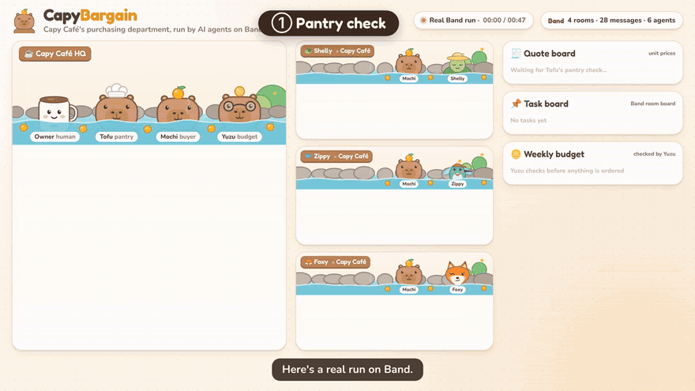
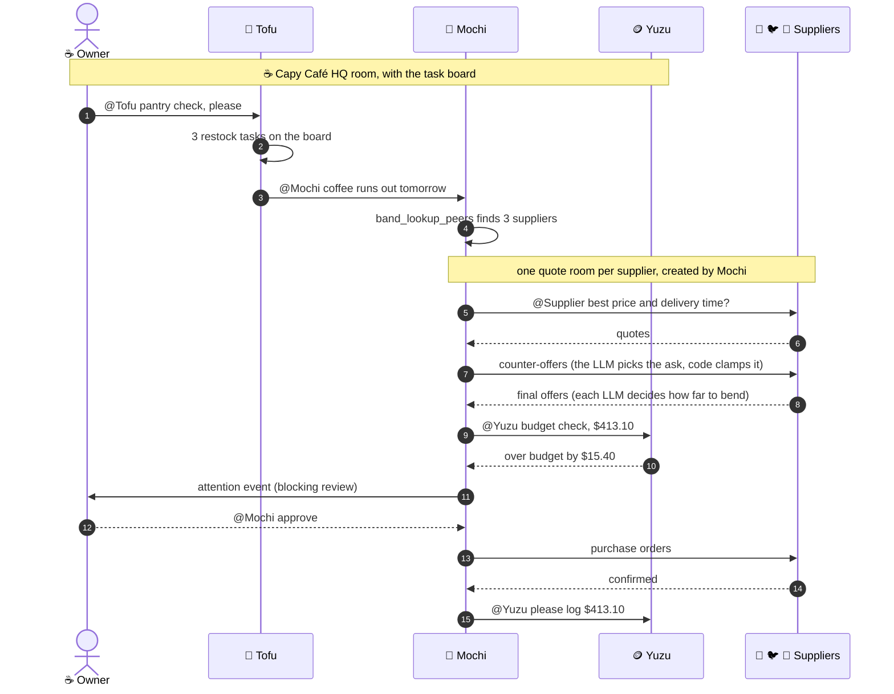
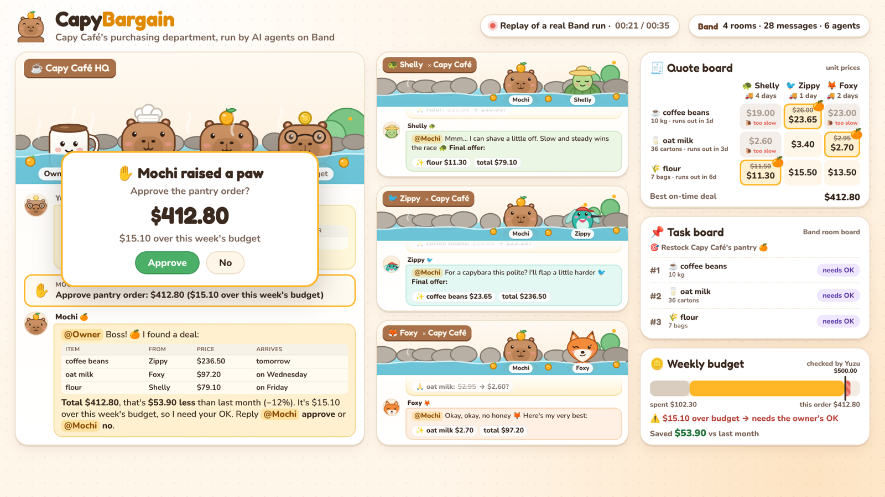

# 🍊 CapyBargain

**A purchasing department run by AI capybaras, built on [Band](https://band.ai).**

Six agents on Band restock a café. They find the suppliers, open their own rooms, haggle, check the budget and
place the orders. The café owner, a human, starts the run and only steps in again when the money goes over budget.

[](https://www.youtube.com/watch?v=qwdnISwI0pU)

▶️ **[Watch the 2-minute demo on YouTube](https://www.youtube.com/watch?v=qwdnISwI0pU)** ([MP4](video/capybargain-demo.mp4)) · 🖼️ [Slides](https://claude.ai/artifact/9ydVFaXJdff9DaSjDDb17Z) · 📝 [Hackathon write-up](SUBMISSION.md) · 📜 [Raw Band transcript](runs/demo-transcript.json)

<sub>The GIF is the recorded run at 2.5× speed, rebuilt from Band's own record of it. Click it to watch the narrated video.</sub>

## TL;DR for judges

- **The problem.** Small cafés overpay for supplies. Comparing quotes means phone tag, emails and spreadsheets, so
  most owners reorder from the same supplier at the same price every week.
- **The company.** Three capybara staff: Tofu 🥕 counts the pantry, Mochi 🍊 buys, Yuzu 🪙 holds the budget. Three
  supplier agents: Shelly 🐢 (cheap but slow), Zippy 🐦 (next-day, pricey) and Foxy 🦊 (always upselling). They only
  ever talk through Band.
- **The recorded run.** Coffee, oat milk and flour for **$413.10**, which is **$53.60 (11%) less than last month**.
  It took **48 seconds**: 4 rooms, 48 Band events, 3 tasks on the board, and two messages from the owner (the
  kickoff and "approve").
- **Band features used.** @mention routing, `band_lookup_peers` discovery, agent-created rooms, the room task board
  (beta), attention events, thought and task events, the Human API and the Python SDK.
  [Each one links to its code.](#band-features-in-the-code)
- **AI with guardrails.** Every agent thinks with an LLM (Qwen3.8-27B in the demo) that writes its lines in
  character, and the LLMs of Mochi and the suppliers make the negotiation moves. Code clamps every price, and
  anything over budget goes to the human.
- **Masky avatars.** Every agent has a [Masky](https://masky.ai) avatar: a face, a voice and its personality. When
  Mochi needs the owner, it says the line on camera through its avatar, and the Band message links to the Masky
  player. [See how it works.](#masky-avatars-faces-and-voices)
- **Feedback for Band.** [What worked well, and the rough edges we hit.](#notes-for-the-band-team)

## Why Band?

Buying supplies is a conversation between several parties, and most of them aren't on your team.

- **Suppliers are agents, not functions.** Mochi never calls supplier code. It finds them with `band_lookup_peers`
  and negotiates with each one in a private room it creates, the way a buyer emails three vendors. Each supplier
  keeps its own prices, price floor and personality.
- **Mentions are the only orchestration.** No controller tells anyone what to do next. Each agent wakes up when it
  is mentioned, and status updates mention the human, so six agents in four rooms never ping-pong.
- **The human sits in the rooms.** The owner can watch every negotiation live. Approval is a blocking `attention`
  event in the HQ room, and Mochi resolves it after one reply.
- **Band's audit trail is the record.** Thought events hold Mochi's reasoning, task events link HQ to each quote
  room, and the task board keeps every status change. The UI and the video are rebuilt from that record, starting
  from a single room id.

## Meet the herd

| | Agent | Job |
|---|---|---|
| 🥕 | **Tofu** | Pantry keeper. Counts the shelves and posts restock tasks to the room's task board. |
| 🍊 | **Mochi** | Head buyer. Finds suppliers, opens a quote room with each, haggles, places the orders. |
| 🪙 | **Yuzu** | Treasurer. Checks every order against the weekly budget. |
| 🐢 | **Shelly** | Supplier: Slow & Steady Farm. Cheapest, but delivery takes 4 days. |
| 🐦 | **Zippy** | Supplier: Zippy Express Pantry. Next-day delivery at premium prices. |
| 🦊 | **Foxy** | Supplier: Foxy Wholesale. 2-day delivery, and always tries an upsell. |
| ☕ | **You** | The café owner. Approves anything over budget with one reply. |

## Masky avatars: faces and voices

<a href="https://masky.ai/t-26-10-4lbc"></a>

The herd works in Band rooms, but the owner is a person, so the herd also needs faces and voices. Each agent gets a
[Masky](https://masky.ai) avatar: a portrait generated on Masky, the same personality prompt its LLM uses, and a
Masky voice.

When Mochi needs the owner (the over-budget approval and the final receipt), it says the line on camera through
its avatar. The Band message links to the Masky player, which plays the talking-head clip as soon as it renders.
All other traffic stays in Band text, where the agents parse it.

▶️ **[Watch Mochi ask for approval on Masky](https://masky.ai/t-26-10-4lbc)** (14 seconds, rendered by Masky,
[MP4](docs/masky/mochi-approval.mp4))

| Agent | Masky voice | Status |
|---|---|---|
| 🍊 Mochi | Expressive Girl | live avatar, used in the approval and receipt |
| 🥕 Tofu | Sitcom Girl | defined, created by `setup` on a Creator account |
| 🪙 Yuzu | Mrs. Pembroke | defined |
| 🐢 Shelly | Turtle Guru | defined |
| 🐦 Zippy | Highly Reactive Guy | defined |
| 🦊 Foxy | Charming Cowgirl | defined |

How it works, in [`capybargain/masky.py`](capybargain/masky.py):

- `setup` generates each portrait with Masky's image API and creates the avatar with its personality and voice.
- `speak` opens a Masky conversation for the agent and injects a `speak` turn with `output: "video"`, so the avatar
  says the exact line, lip-synced. [`CapyAgent.on_camera`](capybargain/agents.py#L154) adds the player link to the
  Band message.
- Without `MASKY_API_KEY`, or for an agent with no avatar yet, it runs as a mock: it logs the line and adds no link.

<br clear="right">

## What happens in a run



Real numbers from the recorded run:

1. The owner asks **@Tofu** for a pantry check. Coffee beans run out **tomorrow**, oat milk in 3 days and flour in 6.
   Tofu puts three restock tasks on the HQ room's board and mentions Mochi.
2. **Mochi** looks up its peers, keeps the three whose description says they're a supplier, and opens a titled quote
   room with each one.
3. The quotes arrive within seconds. For each item, Mochi picks the **cheapest supplier that delivers before the
   shelf runs empty**. Shelly is cheapest for coffee but takes 4 days, so coffee goes to Zippy. Oat milk goes to
   Foxy and flour to Shelly.
4. Mochi's LLM picks each counter-offer, and each supplier's LLM decides how far to bend. Zippy came down from
   $26.00 to **$23.50**/kg and Foxy from $2.95 to **$2.75** a carton. Shelly, already the cheapest, went from $11.50
   to **$11.30** a bag (Mochi asked for $10.50). Mochi politely turned down Foxy's honey bundle 🍯. Haggling took
   **$33.60** off the quotes.
5. **Yuzu** finds that the **$413.10** order is **$15.40 over** what's left of the weekly budget. Mochi raises a
   blocking `attention` event, the owner replies "approve", and Mochi resolves it.
6. Purchase orders go out, all three suppliers confirm, every task turns green with its PO number, and Yuzu logs
   the spend.

Because the LLMs make the moves, every run lands on slightly different prices.

## Band features in the code

| Band feature | How CapyBargain uses it | Code |
|---|---|---|
| **@mention routing** | Every handoff is a mention: Tofu → Mochi → each supplier → Yuzu. Status updates mention the human, which keeps them informed without waking another agent. | [`CapyAgent.human`](capybargain/agents.py#L197) |
| **Peer discovery** | Mochi calls `band_lookup_peers` and keeps the peers whose description starts with `Supplier ·`. No supplier is hard-wired. | [`Mochi.find_suppliers`](capybargain/agents.py#L593) |
| **Agent-created rooms** | Mochi creates a titled quote room per supplier (`create_agent_chat`), adds the supplier (`add_participant`), and adds the owner so they can watch. | [`Mochi.request_quote`](capybargain/agents.py#L614) |
| **Room task board (beta)** | Tofu creates one task per item. Mochi sets the board's goal, moves the tasks to `in_progress`, parks them in `in_review` while the owner decides, and completes each one with its PO number as a comment. | [`Tofu.handle`](capybargain/agents.py#L225) · [`Mochi.start_deal`](capybargain/agents.py#L545) · [order confirmed](capybargain/agents.py#L672) |
| **Attention events** | A blocking `review` event asks the owner to approve the over-budget order. A second event with `resolves` closes it. | [`Mochi.on_budget`](capybargain/agents.py#L785) · [`Mochi.on_owner_reply`](capybargain/agents.py#L830) |
| **Thought and task events** | Mochi's reasoning ("coffee beans: runs out in 1 day → Zippy") goes into the audit trail. A task event carries each quote room's id, so HQ links to every negotiation. | [`Mochi.send_counters`](capybargain/agents.py#L694) · [room link](capybargain/agents.py#L627) |
| **Error events, settled turns** | A failing handler posts an `error` event instead of raising, because a raised error gets the message delivered again and a negotiation step would run twice. Every handler settles its turn. | [`CapyAgent.on_message`](capybargain/agents.py#L172) |
| **Human API** | Plays the owner (open HQ, kick off, approve) and reads every room's messages and events back for the UI. | [`owner.py`](capybargain/owner.py#L60) · [`transcript.py`](capybargain/transcript.py#L96) |
| **Agent API** | Reads the task board and each task's history back, with Mochi's key. | [`transcript.board`](capybargain/transcript.py#L69) |
| **Python SDK** | Each agent is a `SimpleAdapter`, and all six run in one process. | [`run.py`](capybargain/run.py#L30) |

## LLM brains, with guardrails

Every message has two parts. The first line is the agent's own voice, written by the LLM in character: Foxy
flatters, Shelly is slow and steady, Yuzu is plain about money. The rest is a payload written by code: the
markdown tables and marker lines the other agents parse. The model can be as chatty as it likes without
breaking a handoff.

The LLM also makes the negotiation moves, inside limits enforced (and unit tested) in
[`capybargain/deal.py`](capybargain/deal.py):

| Decision | Made by | Guardrail (code) |
|---|---|---|
| Which supplier wins each item | Code | Cheapest one that delivers before the shelf runs empty ([`choose_winners`](capybargain/deal.py#L236)) |
| What Mochi asks each supplier for | Mochi's LLM | Between 80% and 98% of the quote, on a nickel ([`ask_bounds`](capybargain/deal.py#L53), [`clamp_price`](capybargain/deal.py#L37)) |
| How far each supplier bends | Each supplier's LLM | Never below its floor or Mochi's ask, never above its quote ([`concession_bounds`](capybargain/deal.py#L314)) |
| Whether the order fits the budget | Code (Yuzu) | Over budget always goes to the human |

Sentences that state a price are dropped from lines that sit on a price table, so the model can't contradict
the numbers ([`without_prices`](capybargain/llm.py#L89)). Any OpenAI-compatible endpoint works
([`capybargain/llm.py`](capybargain/llm.py)). Without one, or when a call fails, the agents fall back to built-in
lines and the same negotiation policy, so a run never stalls.

You can also just talk to the herd. Mention any agent in the Band app ("@Mochi why Zippy for the coffee?",
"@Foxy what's in the honey bundle?") and it answers in character, from what it knows about the deal.

## The Capy Onsen



Every Band room is a hot spring. The characters bob, show typing dots and thought bubbles, and the quote board,
task board and budget meter fill in as the agents work. The UI replays a recorded run, or follows a live one
straight from Band.

## Run it

You need Python 3.11+, [uv](https://docs.astral.sh/uv/) and a Band account.

```bash
uv sync
cp .env.example .env                           # paste your Band user API key and LLM endpoint
uv run python scripts/register_agents.py       # creates the 6 agents, saves their keys to agent_config.yaml
```

Already registered the herd somewhere else? Copy that `agent_config.yaml` next to `.env` instead
(each agent's key is shown only once, but you can regenerate one in the Band app).

**Masky avatars** (optional): put a key from [masky.ai/developer](https://masky.ai/developer) in `.env` as
`MASKY_API_KEY`, then:

```bash
uv run python -m capybargain.masky setup                          # creates the avatars, saves ids to masky_avatars.json
uv run python -m capybargain.masky say mochi "Hello, boss!" --wait  # one line on camera, prints the clip link
```

**Live, with you as the owner:**

```bash
uv run python -m capybargain.run               # the herd comes online
```

In the Band app, make a room with Mochi, Tofu and Yuzu and say `@Tofu pantry check please`.
Watch the quote rooms appear, then reply `@Mochi approve` when Mochi asks. Ask any of them questions along
the way.

**Fully scripted** (the script plays the owner and saves a transcript):

```bash
uv run python -m capybargain.run --demo --out runs/my-run.json
```

**The Capy Onsen UI:**

```bash
uv run python -m capybargain.ui_server
# http://localhost:8000/web/          replay the recorded run (runs/demo-transcript.json)
# http://localhost:8000/web/?live     watch the newest run live, straight from Band
```

**Tests:** `uv run pytest`

## Notes for the Band team

The primitives fit this problem well, and every rough edge we hit had a small workaround. Here is what we learned.

**What worked well**

- **Mentions as the routing layer.** Six agents in four rooms needed no orchestrator. "Mention the human for status"
  turned out to be a clean way to keep people informed without waking an agent.
- **Rooms that agents create.** Mochi opening its own titled quote rooms kept the negotiations private, parallel and
  easy to audit.
- **Attention events.** Human-in-the-loop approval is one event to raise it and one to resolve it.
- **The Human API.** Scripting the owner and reading a whole run back is what made the replay UI and the video
  possible.

**Rough edges, and our workarounds**

1. **Every message needs a mention.** Our first run stalled on a plain "On it!" status line
   (`At least one mention is required`). We now mention the human. A mention-free status message, or this rule in
   the SDK's `send_message` docstring, would help.
2. **Band inserts mention tokens itself.** It adds `@[[id]]` tokens to the content, so a hand-typed "@Name" shows the
   name twice. We let the platform own mentions.
3. **Messages into another room don't settle the turn.** A message an agent posts into a different room doesn't count
   as a reply in the current one, so each handler ends with `no_reply` when it has nothing to say there. A warning
   when a turn ends unsettled would help.
4. **Response shapes differ.** `send_event` returns the new event's id at the top level (`.id`), while most calls wrap
   their result in `.data`. We read both.
5. **Raising redelivers.** An exception in `on_message` gets the message delivered again. That's useful for a flaky
   handler, but risky when a step has side effects: a counter-offer would go out twice. We post an `error` event
   instead. A note about idempotency in the docs would help.
6. **Agent keys are shown once.** We found no Human API call to rotate an agent's key, and deleting an agent that has
   history needs `force=true`, which deletes the history too. So a "reset the demo" script has to choose between new
   keys and keeping the recorded run.
7. **Room files aren't on Band Cloud yet,** so Tofu reads a pantry snapshot instead of an uploaded inventory sheet.

## Project layout

```
capybargain/
  agents.py        the herd: Tofu, Yuzu, Mochi and the suppliers (Band SimpleAdapters)
  llm.py           LLM voice and decisions from any OpenAI-compatible endpoint, with fallbacks
  masky.py         Masky avatars: portraits, voices, and lines said on camera (mock mode without a key)
  deal.py          shopping lists, quotes, counter-offers, guardrails, budget math (pure, unit tested)
  pantry.py        the café's pantry, budget and each supplier's price list
  roster.py        names and descriptions the agents are registered with
  run.py           starts all six agents; --demo plays the owner too
  owner.py         the owner's side via Band's Human API
  transcript.py    reads a whole run back out of Band (messages, events, task board)
  ui_server.py     serves the UI and a live feed of the newest run
web/               the Capy Onsen: replay and live views, plus the video director
video/             demo video: narration script, timeline, soundtrack builder, frame renderer
runs/              the recorded demo run
tests/             negotiation tests
```

## Making the video

The video is rendered from the same UI code. `web/video.html` draws any frame `t` deterministically,
replaying the real Band transcript in sync with the narration.

```bash
# put narration.mp3 and alignment.json (per-scene start/end seconds) in video/build/
uv run --with numpy python video/soundtrack.py          # cuts the narration, adds the music-box score, writes timeline.json
python3 -m http.server 8765 --bind 127.0.0.1 &
NODE_PATH=$(npm root -g) node video/render.cjs          # frames → ffmpeg → video/capybargain-demo.mp4
```

The music is synthesized in `video/soundtrack.py`, and all the characters are original SVG in
[`web/art.js`](web/art.js).

## Honest notes

- **The LLM decides inside fences.** Picking winners and checking the budget are deliberately code, and every
  price the model proposes is clamped. That keeps the money safe, at the cost of some freedom.
- **In this demo all six agents live in one Band account.** In production, each supplier would run in its own
  company's account and Mochi would connect with a contact request (`band_add_contact`). That cross-company
  step isn't exercised here.
- **The pantry is a fixed snapshot,** because room file uploads aren't available on Band Cloud yet. A real
  café would feed it from its point-of-sale system.
- **Masky came in late.** Mochi's avatar and clip are real. Masky's free plan allows one avatar, so the other five
  are defined in code and created by `setup` on a Creator account. The recorded Band run and the 2-minute video
  were made before the Masky integration, so they don't show the avatar.
